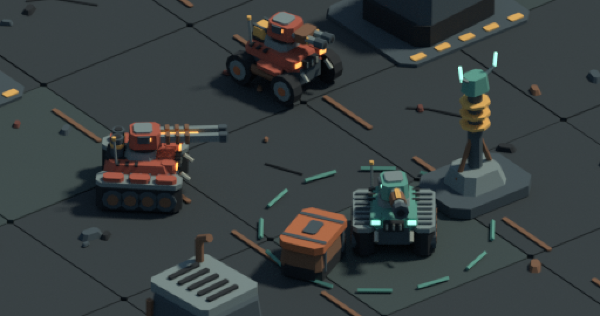

# 아르비토 · ARVITO

멸망한 지구의 제9 중계소에서 깨어난 탐사 로봇. 적 기체를 해체하면 차체와 무기뿐 아니라 **그 기체가 쓰던 행동 명령의 낱말**까지 가져올 수 있다. 세 차례 습격을 견디고 중계소로 귀환하는 PC용 싱글플레이 생존 게임 초안이다.

*게임에 쓰인 3D 모델과 도트 배율로 만든 Blender 렌더.*

## Unity에서 실행

1. Unity Hub에서 **Unity 6.3 LTS (6000.3.28f1)**를 준비한다.
2. **Add project from disk**로 [Unity/Arvito](Unity/Arvito) 폴더를 연다.
3. [RelayBasin 씬](Unity/Arvito/Assets/Scenes/RelayBasin.unity)을 열고 **Play ▶**를 누른다. 게임 화면에서 **Enter** 또는 **출격**을 선택한다.

| 조작 | 기능 |
| --- | --- |
| WASD / 방향키 | 화면 기준 이동 |
| E | 근처 고철·파괴된 기체에서 부품과 칩 회수. 세 번째 습격 뒤 중계소 안에서 귀환 |
| Tab / Esc | 현장 조립대 열기·닫기. 정비 중에는 전투와 탄환이 멈춘다 |
| 마우스 | 조립대의 소켓 선택, 호환 부품·칩 장착 또는 분리 |
| Enter | 출격 또는 결과 화면에서 다시 시작 |

출격 직후 옆의 **정비 보관함**에서 E를 누른다. Tab으로 조립대를 열고 **행동 칩 → 누가 → 중계 드론**을 장착해 보자. 같은 리벳 발사기도 이제 기체 주위를 도는 드론의 위치에서 표적을 찾아 발사한다. 화면 오른쪽 지도에는 기체, 회수할 잔해, 귀환할 중계소가 표시된다.

## 행동 회로

기본 명령은 **“본체가 항상 사거리 안에서 가장 가까운 적 기체에 직선 발사한다”**이다. 각 소켓의 칩을 독립적으로 교체한다.

| 소켓 | 회수 가능한 칩 | 전투에서 바뀌는 것 |
| --- | --- | --- |
| 누가 | 본체 · 중계 드론 | 탐색과 발사의 기준점 |
| 언제 | 항상 · 이동 중 · 정지 중 | 명령을 실행하는 시점 |
| 어디서 | 사거리 안 · 전방 부채꼴 · 근거리 | 탐색 영역. 부채꼴은 전방 120도, 근거리는 무기 사거리의 안쪽 절반 |
| 무엇을 | 적 기체 · 손상된 적 | 표적 후보 |
| 왜 | 가장 가까운 · 내구가 낮은 · 화력이 높은 | 후보 중 하나를 고르는 우선순위 |
| 어떻게 | 직선 발사 · 예측 발사 | 현재 위치로 조준하거나 표적 속도로 탄착점을 예측 |

칩을 분리하면 인벤토리로 돌아간다. 한 칸이라도 비면 무기가 대기한다. 차체와 동력원이 작동하면 이동과 회수는 계속할 수 있다.

## 회수와 생존

- **물리 부품 9종**이 있다. 차체는 최대 내구와 이동 속도, 동력원은 공급 출력, 무기는 사거리·연사·피해·탄속을 결정한다. 차체와 무기의 소비 전력 합계가 공급 출력을 넘으면 장착할 수 없다.
- **고철과 적 잔해**에서 모두 장착 가능한 모듈을 얻는다. 질주병은 이동 중 근거리 예측 사격을 하고, 중계 감시기는 정지한 채 드론으로 전방을 감시한다. 적이 사용한 부품 3개와 칩 6개가 그 기체의 잔해에 그대로 남는다.
- **엄폐물**은 표적 탐색과 탄환을 차단한다. 적 잔해를 회수하면 내구를 최대 22만큼 현장 수리한다. 차체를 바꿀 때는 기존 내구 비율을 이어받는다.
- **귀환**하려면 세 번째 습격의 적까지 제거하고 시작 지점의 중계소 원 안에서 E를 누른다.

## 프로젝트

- [부품과 행동 칩](Unity/Arvito/Assets/Scripts/Core/Equipment.cs), [조준·우선순위](Unity/Arvito/Assets/Scripts/Core/Combat.cs), [전투·회수·습격](Unity/Arvito/Assets/Scripts/Core/Field.cs)은 Unity 화면 없이도 실행 가능한 C# 코드다.
- [현장 렌더링](Unity/Arvito/Assets/Scripts/Play)과 [3D 모델](Unity/Arvito/Assets/Resources/Arvito/Models)은 URP에서 동작한다. 카메라는 3D 월드를 저해상도 텍스처에 그려 포인트 필터로 확대한다. 한글 HUD는 화면 해상도로 표시한다.
- [코어 검증](Tests/Arvito.CoreChecks)은 .NET 8에서 `dotnet run --project Tests/Arvito.CoreChecks`로 실행한다. 칩 분리와 교체, 출력 부족, 회수, 조준, 기체 파괴, 세 차례 습격 후 귀환을 검사한다.
- 한글 글꼴은 Noto Sans KR을 사용한다. [SIL Open Font License](Unity/Arvito/Assets/Art/OFL-NotoSansKR.txt)
